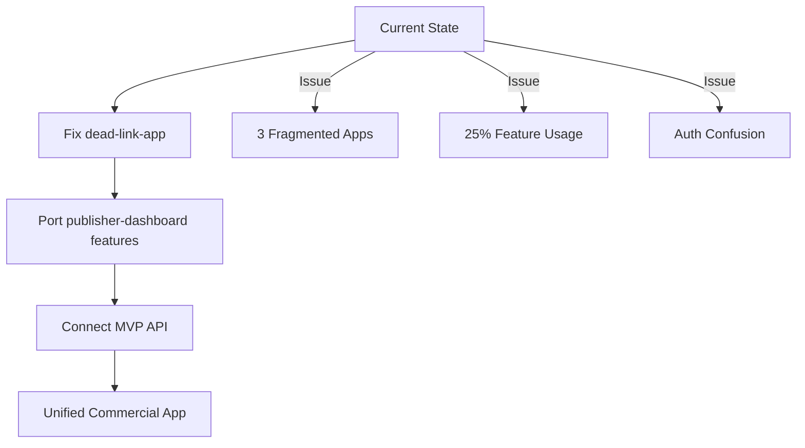

# Dead Link Switchboard - Complete Project Overview

**Status:** MVP Complete with Critical Integration Gaps  
**Backend:** ✅ 95% Complete | **Frontend Integration:** ❌ 25% Complete  
**Last Updated:** $(date)

## 🏗️ Project Architecture

This is a **multi-component link management platform** with separate frontend and backend applications that need integration work.

### Current Applications

| Application | Purpose | Status | Primary Use |
|------------|---------|--------|-------------|
| **dead-link-switchboard-api** | Backend API | ✅ MVP Complete | Cloudflare Workers API |
| **dead-link-app** | Main Business App | ⚠️ 30% Complete | Target Primary App |
| **publisher-dashboard** | Technical Dashboard | ✅ 85% Complete | Current Working App |
| **dead-link-switchboard-landing** | Marketing Site | ✅ Complete | Marketing Only |

## 🚨 Critical Integration Issues

### **The Main Problem**
We have a **fully-featured backend API** but **fragmented frontends** that only use 25% of available features.

### **Application Comparison**

#### **dead-link-app** (Recommended Primary)
```bash
cd dead-link-app
npm run dev  # Port 3000
```

**✅ Strengths:**
- Professional marketing site with conversion-focused design
- Complete authentication system (signup, signin, sessions)
- Superior architecture with route groups
- Business-ready branding and messaging
- Modern tech stack (Next.js 15, Tailwind v4, Framer Motion)

**❌ Critical Gaps:**
- Dashboard pages are **completely empty** (links, analytics, settings)
- Shows hardcoded "0" values instead of real data
- Missing integration with MVP API endpoints
- No access to new features (QR codes, bulk ops, GDPR, etc.)

#### **publisher-dashboard** (Currently Functional)
```bash
cd publisher-dashboard
npm run dev  # Port 3001
```

**✅ Strengths:**
- Complete link management (create, edit, delete)
- Rich analytics with charts and data visualization
- Geographic data and bot detection
- CSV export functionality
- Real data integration

**❌ Limitations:**
- No marketing presence (technical tool only)
- Uses old API endpoints (missing new features)
- Basic design (admin panel aesthetic)
- API key auth only (no user accounts)

## 🔧 Backend API Status

### **Fully Implemented MVP Features** ✅

The backend API (`dead-link-switchboard-api`) is **production-ready** with:

```typescript
// Core Features
POST /api/v1/links              // Create links with custom slugs
POST /api/v1/links/bulk         // Bulk operations (up to 100)
GET  /api/v1/qr/:slug          // QR code generation
PUT  /api/v1/links/:slug       // Link expiration settings

// User Management
POST /api/auth/reset-password   // Password reset flow
GET  /api/user/data-export     // GDPR data export
POST /api/user/delete-account  // GDPR data deletion
GET  /api/user/usage           // Usage tracking & limits

// Advanced Features
POST /api/webhooks             // Webhook management
GET  /api/keys                 // API key management
GET  /api/health               // Health monitoring
```

### **Security Features** 🔒
- bcrypt password hashing (10 rounds)
- CSRF protection on all endpoints
- Rate limiting (5 login attempts/15 min)
- Webhook HMAC signatures
- Comprehensive error logging
- Database backup/migration system

## 📊 Integration Gaps Analysis

### **Features Backend Has But Frontend Missing**

| Feature | Backend API | dead-link-app | publisher-dashboard | Gap Impact |
|---------|------------|---------------|-------------------|------------|
| **Custom Slugs** | ✅ Complete | ❌ Missing | ❌ Missing | High |
| **QR Codes** | ✅ Complete | ❌ Missing | ❌ Missing | High |
| **Bulk Operations** | ✅ Complete | ❌ Missing | ❌ Missing | High |
| **Link Expiration** | ✅ Complete | ❌ Missing | ❌ Missing | High |
| **Usage Limits** | ✅ Complete | ❌ Missing | ❌ Missing | Critical |
| **Password Reset** | ✅ Complete | ❌ Missing | ❌ Missing | Critical |
| **GDPR Compliance** | ✅ Complete | ❌ Missing | ❌ Missing | Legal Risk |
| **Webhooks** | ✅ Complete | ❌ Missing | ❌ Missing | Medium |

### **Authentication Chaos** 🔥

Currently have **3 different auth systems**:

```typescript
// Backend API (supports both)
✅ Session-based auth with secure cookies
✅ API key authentication with scoping

// dead-link-app 
✅ Uses session auth (good!)
❌ Dashboard shows hardcoded data (bad!)

// publisher-dashboard
✅ Uses API key auth (works!)
❌ Calls old endpoints (missing features!)
```

## 🎯 Recommended Solution

### **Phase 1: Make dead-link-app the Primary App**

**Why dead-link-app should win:**

1. **🏢 Commercial Foundation**
   - Professional marketing site drives sign-ups
   - Business-focused messaging and pricing
   - Complete user onboarding flow

2. **🔧 Superior Architecture**
   - Better code organization with route groups
   - Scalable authentication system
   - Modern tech stack ready for growth

3. **👥 Target Market**
   - Aims at business users (bigger market)
   - Session-based auth (better UX)
   - Revenue-focused value proposition

### **Integration Roadmap**



#### **Week 1: Critical Fixes**
```bash
# 1. Implement missing dashboard pages in dead-link-app
touch dead-link-app/app/(dashboard)/links/page.tsx
touch dead-link-app/app/(dashboard)/analytics/page.tsx  
touch dead-link-app/app/(dashboard)/settings/page.tsx

# 2. Connect real API data instead of hardcoded values
# 3. Fix CORS for all frontend origins
# 4. Standardize authentication
```

#### **Week 2: Feature Integration**
```bash
# 5. Port rich analytics from publisher-dashboard
# 6. Add missing MVP features (QR codes, bulk ops, etc.)
# 7. Implement password reset UI flow
# 8. Add GDPR compliance features
```

#### **Week 3: Polish & Launch**
```bash
# 9. Unified design system
# 10. Complete user experience testing
# 11. Production deployment
```

## 🚀 Quick Start Guide

### **For Development:**

```bash
# 1. Start Backend API
cd dead-link-switchboard-api
npm install
wrangler dev  # Port 8787

# 2. Start Primary Frontend (dead-link-app)
cd dead-link-app  
npm install
npm run dev   # Port 3000

# 3. Optional: Start Publisher Dashboard for reference
cd publisher-dashboard
npm install  
npm run dev   # Port 3001
```

### **For Testing Current Functionality:**

- **Marketing & Auth**: http://localhost:3000 (dead-link-app)
- **Working Dashboard**: http://localhost:3001 (publisher-dashboard) 
- **API Health**: http://localhost:8787/health
- **API Docs**: See `integrations_prog.md` for endpoint details

## 📁 Key Files to Understand

### **Backend API**
```
dead-link-switchboard-api/
├── src/index-mvp.js           # Main API with all MVP features
├── src/auth-endpoints-secure.js # Secure authentication 
├── src/link-operations.js     # Custom slugs, bulk ops
├── src/gdpr-compliance.js     # Data export/deletion
├── migrations/003_mvp_features.sql # Database schema
└── wrangler.toml             # Cloudflare Workers config
```

### **Frontend Apps**
```
dead-link-app/                 # TARGET: Primary commercial app
├── app/(marketing)/          # Complete landing pages
├── app/(auth)/              # Working authentication
├── app/(dashboard)/         # ❌ EMPTY - needs implementation
└── lib/auth.ts             # Robust auth system

publisher-dashboard/          # REFERENCE: Working features
├── src/app/dashboard/       # Complete dashboard functionality  
├── src/lib/api.ts          # API client (needs updating)
└── src/components/         # Rich analytics components
```

## 🎯 Success Metrics

- [ ] **Single Primary App**: Users know which app to use
- [ ] **100% Feature Access**: All backend features available in UI
- [ ] **Unified Auth**: One authentication system across all apps
- [ ] **Real Data**: No hardcoded values, all live API integration
- [ ] **Commercial Ready**: Complete signup → dashboard → usage flow

## 📋 Current Blockers

1. **No Clear Primary App** - Users confused which to use
2. **Missing Dashboard Pages** - dead-link-app dashboard is empty
3. **API Integration Gaps** - Frontends not using MVP endpoints  
4. **Authentication Fragmentation** - 3 different auth systems
5. **Feature Disparity** - 75% of backend features inaccessible

---

**Next Step:** Choose integration approach and begin implementing missing dashboard pages in dead-link-app

**Estimated Integration Time:** 2-3 weeks  
**Current Risk Level:** 🔴 High - Users cannot access most functionality

**See `integrations_prog.md` for detailed technical analysis**